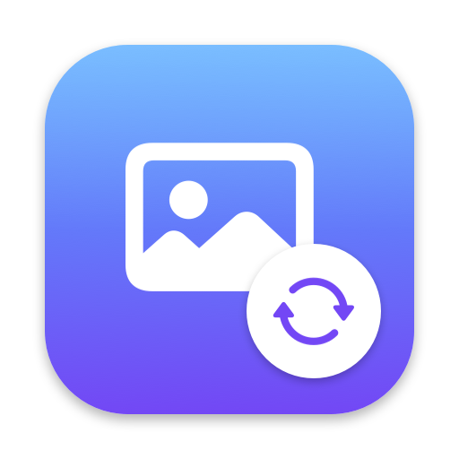

<!-- languages -->
🌐 [English](../README.md) · [Русский](README.ru.md) · [Deutsch](README.de.md) · [Français](README.fr.md) · [Español](README.es.md) · [Italiano](README.it.md) · [Português (Brasil)](README.pt-BR.md) · [Nederlands](README.nl.md) · [Polski](README.pl.md) · [Українська](README.uk.md) · [Čeština](README.cs.md) · **Svenska** · [Türkçe](README.tr.md) · [العربية](README.ar.md) · [עברית](README.he.md) · [हिन्दी](README.hi.md) · [Bahasa Indonesia](README.id.md) · [Tiếng Việt](README.vi.md) · [ไทย](README.th.md) · [日本語](README.ja.md) · [한국어](README.ko.md) · [简体中文](README.zh-Hans.md) · [繁體中文](README.zh-Hant.md)
<!-- /languages -->

# RenameConvert

En menyradsapp för macOS: ändra ett filnamnstillägg i Finder så ändras även filformatet.
`photo.heic` → `photo.jpg`, `clip.mov` → `clip.mp4`, `clip.mov` → `clip.gif`, `report.docx` → `report.pdf`.



## Installation

Hämta **RenameConvert.dmg** från den [senaste versionen](https://github.com/Kohinor46/RenameConvert/releases/latest)
och dra appen till mappen Program. Kräver macOS 15 eller senare, Apple Silicon eller Intel.

Appen är inte notariserad, så macOS blockerar första starten: högerklicka på appen → **Öppna**
(eller **Öppna ändå** i Systeminställningar → Integritet och säkerhet).

## Stöd projektet

RenameConvert är gratis. Om den sparar tid åt dig kan du stödja utvecklingen:

- **Bankkort (ryska banker):** [CloudTips](https://pay.cloudtips.ru/p/253eb33a)
- **USDT, endast TON-nätverket:** `UQBSrz9r4NLiwa13oLu6pmEJVcxldyPba81lkBys5bnhgzJg`
  ⚠️ Skicka bara USDT i TON-nätverket — andra mynt eller nätverk kan gå förlorade.

Samma alternativ, med QR-kod, finns i appen: menyn → ”Stöd projektet ♥…”.

## Funktioner

| Kategori | Från | Till |
|---|---|---|
| Bilder | jpg, png, heic, webp, gif, tiff, bmp, RAW med mera | jpg, png, heic, avif, **webp**, gif, tiff, bmp, jp2, ico, icns, psd, tga, pdf |
| Video | mov, mp4, m4v, 3gp, **mkv, avi, webm, flv, wmv, mpg, ts, mts, ogv** | mov, mp4, m4v, **mkv** · **gif** · ljud (m4a, **mp3**, wav, aiff, caf, flac) · bildruta (jpg, png…) |
| GIF | gif | mp4, mov, m4v, webp (animerad) |
| Ljud | mp3, m4a, aac, wav, aiff, caf, flac, **ogg, opus, wma, ac3, amr, ape** | m4a, **mp3**, wav, aiff, caf, flac |
| Dokument | txt, rtf, html, docx, doc, odt, webarchive, pdf | txt, rtf, html, docx, doc, odt, pdf · PDF → bild (första sidan) |
| Data | json, plist | json, plist |
| Arkiv | zip, tar, tar.gz, tar.bz2, tar.xz, 7z | samma |

Format som macOS inte klarar på egen hand (WebP, MP3, MKV, AVI, WebM, OGG…) konverteras av den inbyggda
**FFmpeg 7.1** (LGPL 2.1, med LAME och libwebp). Den byggs från officiell källkod av `scripts/build-ffmpeg.sh`,
med SHA-256-kontroller, och är bara beroende av systembibliotek.

**Finders snabbmeny:** högerklicka på en fil (eller flera) → **Konvertera till** → välj ett format.
Filen konverteras direkt, som om du hade bytt filändelse. Finder-tillägget slås på vid första starten;
du kan stänga av det i Systeminställningar → Allmänt → Inloggningsobjekt och tillägg (eller i appen: Inställningar → ”Inställningar för Finder-tillägg…”).

**Regler.** För varje par ”från → till” (ett filnamnstillägg, en kategori eller ”alla”) väljer du vad som händer:
fråga först, konvertera direkt eller konvertera inte – och om originalet ska behållas.
Den mest specifika regeln vinner; som standard är video inställt på ”Fråga” och allt annat på ”Konvertera direkt”.

**Bekräftelsepanelen** visas i det övre högra hörnet: ändra parametrarna för just den här konverteringen
och kom ihåg beslutet för det här paret av filnamnstillägg.

**Parametrar:** kvalitet för JPEG/HEIC/AVIF/WebP; för video – kodek (utan omkodning / H.264 / HEVC),
upplösning (4K…480p, skalas aldrig upp), bildfrekvens, borttagning av plats- och personlig metadata;
bildfrekvens och bredd för GIF; bithastighet för AAC/MP3; sidstorlek för PDF.

**Uppdateringar:** en knapp ”Sök efter uppdateringar” och en automatisk daglig kontroll mot
[GitHub Releases](https://github.com/Kohinor46/RenameConvert/releases). Uppdateringen hämtas,
verifieras med SHA-256 och kodsignatur och installeras med en omstart.

**Felrapport:** menyn → ”Rapportera ett fel…” (eller knappen i en felnotis) skapar ett mejl till
utvecklaren med din beskrivning, systeminformation och appens logg bifogad. Logg:
`~/Library/Logs/RenameConvert/RenameConvert.log`.

**23 språk:** engelska, ryska, tyska, franska, spanska, italienska, portugisiska (Brasilien), nederländska, polska,
ukrainska, tjeckiska, svenska, turkiska, arabiska, hebreiska, hindi, indonesiska, vietnamesiska, thailändska, japanska, koreanska,
kinesiska (förenklad och traditionell).

**Dessutom:** bevakade mappar och undantag, förlopp och avbrytning i menyraden, historik med ”Återställ original”,
original flyttas till papperskorgen, notiser, start vid inloggning. Allt körs lokalt – filerna lämnar aldrig din Mac.

## Bygga

Kräver macOS 15+ och Command Line Tools (`xcode-select --install`). Xcode är valfritt,
men projektet kan öppnas i det som ett Swift-paket (`open Package.swift`).

```bash
./build.sh            # build/RenameConvert.app (universell: Apple Silicon + Intel); bygger FFmpeg vid första körningen (~15 min)
./build.sh install    # installera i ~/Applications och starta
./build.sh dist       # build/RenameConvert.zip (för automatisk uppdatering) och build/RenameConvert.dmg
./build.sh release    # dist + publicera version v<version> på GitHub
```

Översättningar: `scripts/extract-strings.py` samlar gränssnittets strängar i `Resources/Localization/keys.json`;
`--check` kontrollerar att varje språk har alla strängar med matchande platshållare.
Reklamfilmer: `scripts/promo/make-promo.sh` (speakerröst med `say`, SwiftUI-bildrutor, sammanfogade med FFmpeg).

## Arkitektur

| Fil | Syfte |
|---|---|
| `RenameWatcher.swift` | FSEvents: fångar par av typen ”gammalt namn → nytt namn” |
| `Formats.swift` | Formatregister: vilken motor som hanterar ett par filnamnstillägg |
| `Rules.swift` | Regler och konverteringsparametrar |
| `Pipeline.swift` | Arbetsmapp, körning av motorn, original till papperskorgen, atomiskt utbyte |
| `Engines/ImageEngine.swift` | Bilder (ImageIO), PDF → bild |
| `Engines/MediaEngine.swift` | Video, GIF, ljud (AVFoundation, afconvert) |
| `Engines/DocumentEngine.swift` | Dokument (NSAttributedString, PDFKit, CoreText) |
| `Engines/DataArchiveEngines.swift` | JSON ↔ plist, arkiv (bsdtar), gemensamma fel |
| `Engines/FFmpegEngine.swift` | Inbyggd FFmpeg: WebP, MP3, MKV, AVI, WebM, OGG, GIF med palett |
| `Updater.swift` | Söka efter och installera uppdateringar från GitHub Releases |
| `BugReport.swift`, `Log.swift` | Felrapport via mejl, appens logg |
| `AppModel.swift` | Inställningar, kö, frågor, historik, notiser |
| `AskPanel.swift`, `ParamsForm.swift` | Bekräftelsepanel och parameterformulär |
| `RenameConvertApp.swift`, `SettingsView.swift` | Menyradsmeny och inställningsfönster |
| `FinderExtension/`, `FinderMenu.swift` | Finder-tillägg (undermenyn ”Konvertera till”) och hantering av dess förfrågningar i appen |

## Licens för medföljande komponenter

FFmpeg medföljer som en separat körbar fil (`Contents/Helpers/ffmpeg`) under LGPL 2.1, byggd med LAME (LGPL)
och libwebp (BSD). Deras licenstexter finns i `Contents/Resources/Licenses`; det exakta byggskriptet är
`scripts/build-ffmpeg.sh`.
